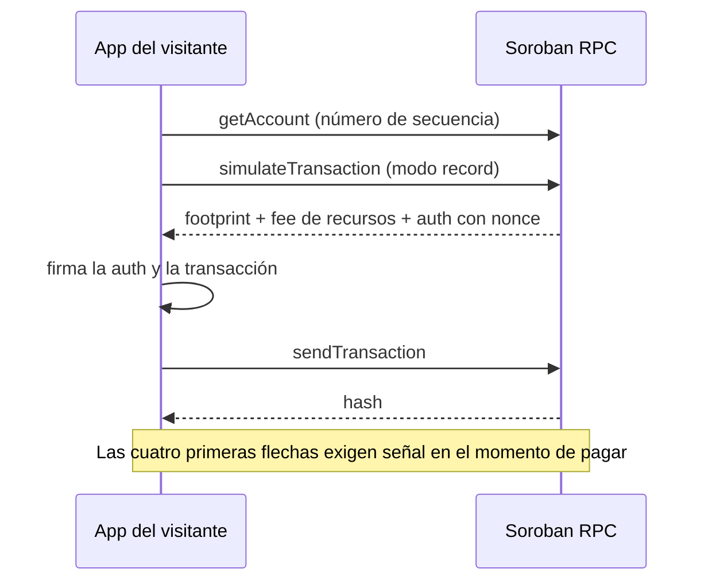
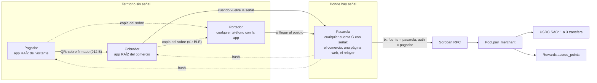
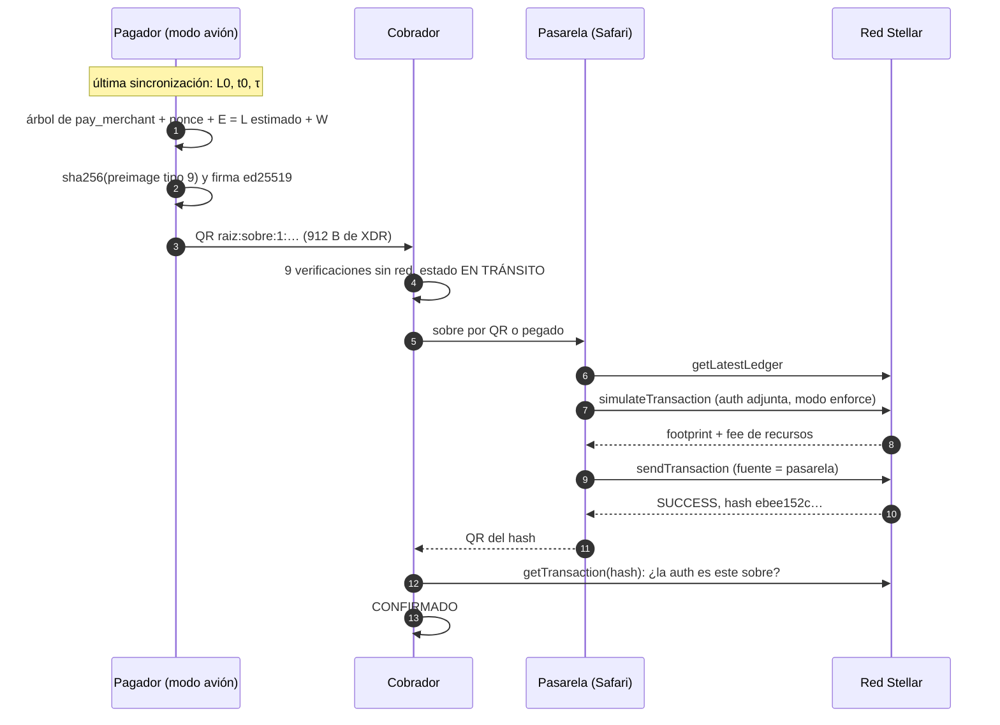
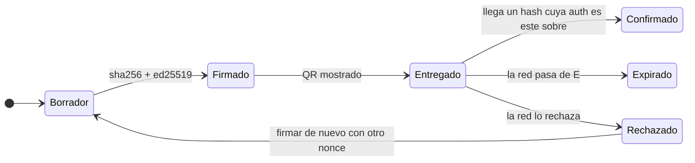
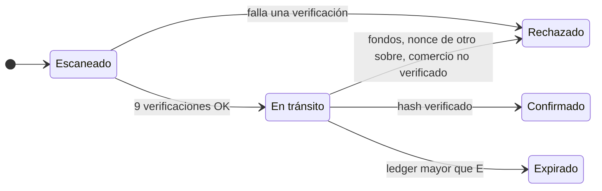

Protocolo RAÍZ · HackMeridian 2026 · camino Scale · track Stellar Unlocked

# Pago diferido por enjambre

Cómo un visitante le paga a un comercio en un territorio sin señal. El visitante firma en modo avión una autorización de Soroban, la entrega por QR, y cualquier teléfono con señal la liquida después. Aquí están los cinco algoritmos, la arquitectura, los flujos y el código, con casos calculados paso a paso y la primera liquidación real en testnet.

Rama `feat/pago-diferido` · spike B1 cerrado el 25-oct-2026 · ningún contrato nuevo: usa `Pool.pay_merchant` tal como está desplegado.

> **Estado (versionado el 26-oct-2026).** Este documento se escribió el 25-oct al mediodía y precede a B2–B4. Lo que
> cambió después: el sobre que viaja es solo `raiz:sobre:1:` + XDR firmado (ajuste 1 aplicado, sin JSON), W = 11 520
> ledgers (ajuste 3), la confirmación es por nonce consumido y por hash cuya auth sea el sobre (ajuste 2), y la
> liquidación es automática en los dos teléfonos (B4: cobrador, portador y pagador; `SobreSettler`). Las secciones
> A1–A5 (algoritmos) y M1–M8 (matemática) siguen vigentes. Las decisiones definitivas están en
> [`docs/pago_diferido_v0.md`](pago_diferido_v0.md) y [`docs/ARQUITECTURA_TECNICA.md` §13](ARQUITECTURA_TECNICA.md).

**912 bytes**sobre firmado (XDR de la entrada)

**5,000 s**cierre de ledger medido en testnet

**3 110 399**ledgers de expiración máxima que acepta la red

**ebee152c…6d47**primera liquidación desde otra cuenta

[01La idea](#idea) [02Por qué no sirve el pago en línea](#online) [03Arquitectura](#arquitectura) [04La pieza del protocolo](#pieza) [A1Construir el sobre](#a1) [A2Estimar el ledger sin red](#a2) [A3Verificar sin red](#a3) [A4Liquidar (la parte en línea)](#a4) [A5Propagar por el enjambre](#a5) [05Seguridad y riesgo](#seguridad) [06Máquinas de estado](#estados) [07Caso ideal de punta a punta](#caso) [08Ajustes para B2](#ajustes) Parte II · La matemática [M1Cuantización en stroops](#m1) [M2El sobre byte a byte](#m2) [M3El QR](#m3) [M4SHA-256 y dominios](#m4) [M5Ed25519](#m5) [M6El estimador como holdover](#m6) [M7Entrega como Poisson](#m7) [M8Error y riesgo](#m8) [—Fuentes](#fuentes)

Índice

[01 · La idea](#idea)[02 · Por qué no sirve el pago en línea](#online)[03 · Arquitectura](#arquitectura)[04 · La pieza del protocolo](#pieza)[A1 · Construir el sobre](#a1)[A2 · Estimar el ledger sin red](#a2)[A3 · Verificar sin red](#a3)[A4 · Liquidar](#a4)[A5 · Propagar por el enjambre](#a5)[05 · Seguridad y riesgo](#seguridad)[06 · Máquinas de estado](#estados)[07 · Caso ideal](#caso)[08 · Ajustes para B2](#ajustes)[M1 · Cuantización](#m1)[M2 · El sobre byte a byte](#m2)[M3 · El QR](#m3)[M4 · SHA-256](#m4)[M5 · Ed25519](#m5)[M6 · Estimador](#m6)[M7 · Entrega](#m7)[M8 · Error y riesgo](#m8)[Fuentes](#fuentes)

01

## La idea en una pantalla

En un pago normal, el teléfono del visitante arma, firma y envía una transacción completa. En el pago diferido firma solo la intención: el árbol de autorización de `pay_merchant` con el monto, el comercio, el aporte y el reparto exactos. Todo lo que necesita red (número de secuencia, recursos, fee) lo pone después quien envíe. A ese objeto firmado lo llamamos **sobre**: una promesa firmada que viaja de teléfono en teléfono y se abre en la red.

### Lo garantiza la red

- Nadie puede cambiar monto, comercio, aporte ni reparto: todo va dentro de lo firmado.
- Cada sobre se cobra una sola vez: la red consume su nonce.
- Un sobre vencido no se cobra nunca: la expiración va en ledgers.
- Un sobre de testnet no sirve en mainnet: el id de red va en lo firmado.
- Cualquiera con señal puede liquidarlo, y nadie puede desviarlo.

### No lo garantiza nadie sin señal

- Finalidad: hasta que llega el hash, el comercio tiene una promesa firmada, no dinero.
- Fondos: sin red nadie ve el saldo del visitante. Lo acotan el tope por pago y, en v1, un bolsillo bloqueado.
- Entrega: un sobre que nadie lleva a la red vence. Se mitiga replicándolo entre portadores.

02

## Por qué el pago en línea no funciona sin señal

El pago de hoy (`PayViewModel.confirm` → `SorobanClient.payMerchant`) depende de la red en el momento de pagar por cuatro motivos. El pago diferido saca cada uno del teléfono del visitante.

| Necesita | Por qué | En el pago diferido |
| --- | --- | --- |
| Número de secuencia del pagador | Toda transacción lleva el siguiente número de secuencia de su cuenta fuente | La cuenta fuente es la pasarela. El visitante no consume secuencia |
| Simulación: footprint y recursos | Soroban exige declarar qué entradas del ledger toca la tx y cuánto cómputo usa | Lo simula la pasarela, que tiene señal |
| Nonce de la autorización | En el flujo normal lo devuelve la simulación en modo record | Lo elige el teléfono con su generador aleatorio seguro |
| XLM para el fee | Lo paga la cuenta fuente | Lo paga la pasarela |



### ¿Por qué no prefirmar una transacción completa?

Una transacción prefirmada fija el número de secuencia del visitante. Si él hace cualquier otra operación, todas las prefirmadas quedan inválidas, y dos pendientes solo se pueden cobrar en orden. Además, para Soroban seguiría faltando la simulación. La autorización de Soroban separa la intención del envío, y esa separación es la pieza del protocolo que hace posible el diseño: por eso el track es Stellar Unlocked.

| Enfoque | Preparación | Doble gasto | Hardware | ¿Sirve en Stellar hoy? |
| --- | --- | --- | --- | --- |
| Canales de pago (Lightning, xLumi) | Abrir un canal 2-de-2 y bloquear fondos por cada par | Lo resuelve el canal | No | Exige un contrato de canal por par |
| Cartera offline con TEE (Jie et al., 2024) | Prefondear una cuenta offline | El enclave lleva el saldo | Intel SGX, que no existe en Android | No en teléfonos |
| Credenciales encadenadas (Si et al., 2026) | Emisión en línea por un centro de pagos | Credencial de vuelto + verificación en lote | Elemento seguro dedicado | Exige un emisor central |
| **Pago diferido RAÍZ v0** | Ninguna: saldo y una sincronización | Nonce on-chain + expiración + tope por pago | No | Sí: autorización de Soroban sin cambios |
| RAÍZ v1 | Bloquear un bolsillo estando en línea | Lo anterior + saldo bloqueado hasta la expiración | Opcional: Key Attestation de Android | Requiere un contrato nuevo |

03

## Arquitectura

Cuatro roles, todos teléfonos del territorio salvo la red. La pasarela no necesita ser de confianza: solo aporta conectividad y XLM para el fee. Por eso un iPhone sin la app, con una página web abierta, sirve de pasarela.



| Rol | Dispositivo | Hace | No puede |
| --- | --- | --- | --- |
| **Pagador** | Teléfono del visitante. v0: wallet semilla | Construye y firma el sobre sin red y lo muestra como QR | Gastar dos veces el mismo sobre |
| **Cobrador** | Teléfono del comercio | Verifica la firma sin red, guarda el sobre, muestra "en tránsito" y lo liquida si tiene señal | Cambiar monto, aporte o reparto |
| **Portador** | Cualquier teléfono con la app | Transporta copias de sobres hasta donde haya señal | Gastarlos ni redirigirlos; en v1 tampoco leerlos |
| **Pasarela** | Cualquier cuenta G con señal: el comercio, una página web, el relayer en v1 | Reconstruye la tx como fuente, simula, paga el fee, envía y devuelve el hash | Alterar la invocación: la firma la fija |

### Componentes por capa

| Capa | Pieza | Estado |
| --- | --- | --- |
| Referencia | `scripts/gen-auth-fixture.mjs` → `deferred_auth_fixture.json` | real |
| Pagador | `data/deferred/AuthTreeBuilder.kt`, `DeferredAuthSigner.kt` | real 16 tests byte a byte |
| Pagador | `LedgerEstimator`, `SobreCodec`, `DeferredStore`, pantalla "Firmar sin señal" | B2 |
| Cobrador | `CobradorVerifier`, `NonceIndex`, lista "Pagos en tránsito" | B4 |
| Pasarela | `landing/pasarela.html` (stellar-sdk JS) | B3 |
| Pasarela | Envío desde Kotlin con otra cuenta (`DeferredAuthTestnetIT`) | real tx `ebee152c…` |
| Red | `Pool.pay_merchant`, USDC SAC, `Rewards.accrue_points` | desplegado sin cambios |
| v1 | Contrato de bolsillo, Key Attestation, portadores BLE, sobre sellado, relayer como pasarela, `raiz-memory` | roadmap |

04

## La pieza del protocolo: la entrada de autorización

Una `SorobanAuthorizationEntry` tiene dos partes: las credenciales (quién firma, con qué nonce, hasta qué ledger y la firma) y el árbol de invocación que autoriza. Los tamaños son los del fixture.

**SorobanAuthorizationEntry**912 B

**credentials · SOROBAN_CREDENTIALS_ADDRESS**232 B

address: G… del pagador · 40 B nonce: int64 · 8 B signatureExpirationLedger: uint32 · 4 B signature: Vec\[ Map{ public_key: 32 B, signature: 64 B } \] · 176 B

**rootInvocation · Pool.pay_merchant(turista, comercio, amount i128, tip_bps u32)**680 B

USDC.transfer(turista, comercio, amount − fee)

USDC.transfer(turista, Pool, tip)solo si tip > 0

USDC.transfer(turista, admin, fee)solo si fee > 0

El borde punteado marca lo que entra en la firma junto con el id de red, el nonce y la expiración.

### Qué bytes se firman

El visitante firma con ed25519 el hash SHA-256 del preimage `ENVELOPE_TYPE_SOROBAN_AUTHORIZATION` (tipo 9). Son 728 bytes en este orden:

9

id de red

n

E

invocación de pay_merchant · 680 B

tipo de envelope = 9 · 4 B network_id = sha256(passphrase) · 32 B nonce · 8 B signatureExpirationLedger · 4 B invocación · 680 B

payload = sha256( 9 ‖ network_id ‖ nonce ‖ E ‖ invocación ) → firma = ed25519(sk_pagador, payload)

Detalle que importa

La dirección del pagador no está en el preimage tipo 9. Queda atada porque el host verifica la firma con los firmantes de esa dirección. Las credenciales V2 de CAP-71 (preimage tipo 10, "with address") la añaden. En Protocol 29 la red sigue aceptando las legacy, que son las únicas que conoce `kmp-stellar-sdk` 1.6.0 (medido en el spike). Migrar cambia el preimage, no el flujo.

### Por qué el visitante puede construir el árbol sin red

`pay_merchant` es determinista para el pagador: el árbol depende solo de los argumentos, de `fee_bps` (se guarda la última vez que hubo red; hoy 50) y de tres direcciones fijas de `deployments.json` (Pool, USDC SAC, admin). `Rewards.accrue_points` lo autoriza el propio Pool y no entra en el árbol del visitante. El script `gen-auth-fixture.mjs --verify-tree` lo comprobó contra la simulación real del host: mismo árbol, 3 sub-invocaciones.

A1

## Construir el sobre (pagador, sin red)

1. Calcular el reparto con la misma aritmética entera que el contrato.
2. Construir el árbol: la raíz más 1 a 3 transfers, según que `tip` y `fee` calculados sean mayores que cero.
3. Elegir el nonce (64 bits aleatorios) y la expiración E (algoritmo A2).
4. Armar el preimage tipo 9 y calcular su SHA-256.
5. Firmar ese hash con ed25519.
6. Insertar la firma como `Vec[Map{public_key, signature}]`.
7. Codificar el sobre y mostrarlo como QR.

### Caso ideal: el fixture, paso a paso

1. amount = 2,5 USDC = 2,5 × 10⁷ = 25 000 000 stroops

   1 USDC = 10 000 000 stroops (7 decimales). El contrato y la app trabajan siempre en enteros.
2. tip = ⌊25 000 000 × 200 / 10 000⌋ = ⌊500 000⌋ = 500 000

   200 puntos básicos son el 2 %. Primero se multiplica y después se divide, como en Rust, para no perder precisión.
3. fee = ⌊25 000 000 × 50 / 10 000⌋ = ⌊125 000⌋ = 125 000

   `ProtocolFeeBps` = 50 (0,5 %) en el Pool desplegado.
4. al comercio = amount − fee = 25 000 000 − 125 000 = 24 875 000

   El contrato descuenta el fee del monto del comercio (ver ajuste 5 de la sección 08).
5. débito del visitante = 24 875 000 + 500 000 + 125 000 = 25 500 000 = 2,55 USDC

   Es lo que el saldo del pagador debe cubrir cuando el sobre llegue a la red. El aporte va encima del monto.
6. monto minúsculo: amount = 49 → tip = ⌊0,98⌋ = 0, fee = ⌊0,245⌋ = 0

   Con montos pequeños el contrato trunca a cero y omite esos transfers. Por eso las ramas del árbol se deciden por el valor calculado, no por los bps: si el árbol incluyera un transfer de 0, la firma no coincidiría con lo que ejecuta el host.

**Calculadora de reparto y árbol**misma aritmética que `AuthTreeBuilder.split`

Monto (USDC) Aporte (bps) Fee del Pool (bps)

AuthTreeBuilder.ktreal · feat/pago-diferido

```kotlin
// android/.../data/deferred/AuthTreeBuilder.kt   (código real, extracto)
object AuthTreeBuilder {
    const val BPS_DENOMINATOR = 10_000L

    /** Misma aritmética entera que el contrato (i128, trunca hacia cero). */
    fun split(amount: Long, tipBps: Int, feeBps: Int): PayMerchantSplit {
        val tip = Math.multiplyExact(amount, tipBps.toLong()) / BPS_DENOMINATOR
        val fee = Math.multiplyExact(amount, feeBps.toLong()) / BPS_DENOMINATOR
        return PayMerchantSplit(tip = tip, fee = fee, toMerchant = amount - fee)
    }

    /** Las ramas se deciden por el valor calculado (tip > 0, fee > 0), no por los bps. */
    fun payMerchantInvocation(
        payer: String, merchant: String, amount: Long,
        tipBps: Int, feeBps: Int, ids: DeferredIds,
    ): SorobanAuthorizedInvocationXdr {
        val s = split(amount, tipBps, feeBps)
        val subInvocations = buildList {
            add(transfer(ids.usdcSac, from = payer, to = merchant,  amount = s.toMerchant))
            if (s.tip > 0) add(transfer(ids.usdcSac, from = payer, to = ids.pool,  amount = s.tip))
            if (s.fee > 0) add(transfer(ids.usdcSac, from = payer, to = ids.admin, amount = s.fee))
        }
        return contractFn(
            contractId = ids.pool, function = "pay_merchant",
            args = listOf(
                Address(payer).toSCVal(), Address(merchant).toSCVal(),
                i128(amount), Scv.toUint32(tipBps.toUInt()),
            ),
            subInvocations = subInvocations,
        )
    }
}

// Caso ideal (fixture): split(25_000_000, 200, 50)
//   → PayMerchantSplit(tip = 500_000, fee = 125_000, toMerchant = 24_875_000)
// payMerchantInvocation(...)  → 680 bytes de XDR, 3 sub-invocaciones
```

DeferredAuthSigner.ktreal · feat/pago-diferido

```kotlin
// android/.../data/deferred/DeferredAuthSigner.kt   (código real, extracto)
object DeferredAuthSigner {
    private val random = SecureRandom()

    /** 64 bits del CSPRNG; puede ser negativo (es un int64 en XDR). */
    fun newNonce(): Long = random.nextLong()

    /** Preimage ENVELOPE_TYPE_SOROBAN_AUTHORIZATION (tipo 9). */
    fun preimage(networkId: ByteArray, nonce: Long, expirationLedger: Long,
                 invocation: SorobanAuthorizedInvocationXdr): HashIDPreimageXdr =
        HashIDPreimageXdr.SorobanAuthorization(
            HashIDPreimageSorobanAuthorizationXdr(
                networkId = HashXdr(networkId),
                nonce = Int64Xdr(nonce),
                signatureExpirationLedger = Uint32Xdr(expirationLedger.toUInt()),
                invocation = invocation,
            ),
        )

    suspend fun sign(entry: SorobanAuthorizationEntryXdr, keyPair: KeyPair,
                     network: Network): SignedDeferredAuth {
        val creds = addressCredentials(entry)
            ?: throw IllegalArgumentException("La entrada no lleva credenciales de dirección")
        val publicKey = keyPair.getPublicKey()
        require(ed25519Of(creds.address)?.contentEquals(publicKey) == true) {
            "El keypair no corresponde a la dirección de la entrada"
        }
        // payload = sha256( XDR( preimage tipo 9 ) )   →   sin red: solo CPU
        val hash = payloadHash(network, creds.nonce.value,
                               creds.signatureExpirationLedger.value.toLong(), entry.rootInvocation)
        val signature = keyPair.sign(hash)                                  // ed25519, 64 bytes
        val signed = entry.copy(credentials = SorobanCredentialsXdr.Address(
            creds.copy(signature = signatureScVal(publicKey, signature)),   // Vec[ Map{public_key, signature} ]
        ))
        return SignedDeferredAuth(entry = signed, payloadHash = hash, signature = signature)
    }
}

// Caso ideal (fixture, nonce 7021436735540711424, E = 6 398 412):
//   preimage   = 728 bytes      payloadHash = 9171aaee3b8db8f0…
//   signature  = 3132df648d3953f2… (64 bytes)      entrada firmada = 912 bytes
```

PayViewModel · SobreCodecpropuesta B2

```kotlin
// Propuesta B2 · ui/pay/PayViewModel, modo "Firmar sin señal"
suspend fun firmarSobre(payer: KeyPair, merchant: String, amount: Long, tipBps: Int): Sobre {
    val ids    = DeferredIds.from(deployments)                 // pool, usdc_sac, admin de deployments.json
    val feeBps = feeCache.bps()                                // leído del Pool la última vez con red (hoy 50)
    val inv    = AuthTreeBuilder.payMerchantInvocation(
                     payer.getAccountId(), merchant, amount, tipBps, feeBps, ids)
    val nonce  = DeferredAuthSigner.newNonce()
    val exp    = estimator.expiration()                        // A2: null si no hay ancla válida
                 ?: throw SinAncla("Conéctate una vez antes de pagar sin señal")
    val entry  = DeferredAuthSigner.unsignedEntry(payer.getAccountId(), nonce, exp, inv)
    val signed = DeferredAuthSigner.sign(entry, payer, Network.TESTNET)
    val sobre  = Sobre(qr = SobreCodec.encode(signed.entry), payer = payer.getAccountId(),
                       nonce = nonce, exp = exp, estado = Estado.FIRMADO)
    store.save(sobre)                                          // DataStore: sobrevive a matar la app
    return sobre
}

/** El QR lleva solo la entrada firmada: todo lo demás se deriva de ella. */
object SobreCodec {
    const val PREFIX = "raiz:sobre:1:"
    const val MAX_CHARS = 4_096                                // corta entradas basura antes de parsear

    fun encode(e: SorobanAuthorizationEntryXdr): String =
        PREFIX + e.toXdrBase64().replace('+', '-').replace('/', '_').trimEnd('=')

    fun decode(qr: String): SorobanAuthorizationEntryXdr? = runCatching {
        require(qr.startsWith(PREFIX) && qr.length <= MAX_CHARS)
        val b64 = qr.removePrefix(PREFIX).replace('-', '+').replace('_', '/')
        SorobanAuthorizationEntryXdr.fromXdrBase64(b64 + "=".repeat((4 - b64.length % 4) % 4))
    }.getOrNull()
}
// Caso ideal: encode(...) → 13 + 1 216 = 1 229 caracteres (el sobre JSON de la spec ocupaba 2 043)
```

gen-auth-fixture.mjsreferencia JS

```javascript
// scripts/gen-auth-fixture.mjs   (referencia con @stellar/stellar-sdk 17, extracto adaptado)
import { xdr, Address, nativeToScVal, Keypair, Networks, authorizeEntry } from '@stellar/stellar-sdk';

const fn = (contract, name, args) =>
  xdr.SorobanAuthorizedFunction.sorobanAuthorizedFunctionTypeContractFn(
    new xdr.InvokeContractArgs({ contractAddress: new Address(contract).toScAddress(),
                                 functionName: name, args }));
const inv  = (contract, name, args, subInvocations = []) =>
  new xdr.SorobanAuthorizedInvocation({ function: fn(contract, name, args), subInvocations });
const addr = (a) => new Address(a).toScVal();
const i128 = (n) => nativeToScVal(BigInt(n), { type: 'i128' });

const root = inv(POOL, 'pay_merchant',
  [addr(payer), addr(merchant), i128(25_000_000), nativeToScVal(200, { type: 'u32' })],
  [ inv(USDC, 'transfer', [addr(payer), addr(merchant), i128(24_875_000)]),   // amount - fee
    inv(USDC, 'transfer', [addr(payer), addr(POOL),     i128(500_000)]),      // aporte 2 %
    inv(USDC, 'transfer', [addr(payer), addr(ADMIN),    i128(125_000)]) ]);   // fee 0,5 %

const entry = new xdr.SorobanAuthorizationEntry({
  credentials: xdr.SorobanCredentials.sorobanCredentialsAddress(
    new xdr.SorobanAddressCredentials({
      address: new Address(payer).toScAddress(),
      nonce: xdr.Int64.fromString('7021436735540711424'),
      signatureExpirationLedger: 0,               // authorizeEntry la fija
      signature: xdr.ScVal.scvVoid() })),
  rootInvocation: root });

const signed = await authorizeEntry(entry, payerKeypair, 6_398_412, Networks.TESTNET);
console.log(signed.toXDR().length);              // 912  →  el test Kotlin exige los mismos bytes
```

El método fixture-byte-a-byte viene de `raiz-confidential-stack`: el JS genera la referencia y el test Kotlin exige los mismos bytes. Si un byte difiere, el test dice cuál.

A2

## Estimar el ledger sin red

La expiración se expresa en ledgers, no en horas, y sin red el teléfono no sabe en qué ledger va la red. La estima desde la última vez que tuvo señal. La pregunta es cuántos ledgers W sumar para garantizar una ventana mínima de cobro aunque la estimación se equivoque.

1. ancla = (L₀, t₀, τ)

   Lo que el teléfono sabe: el último ledger que vio (L₀), el instante en que lo vio según el reloj monotónico (t₀) y el tiempo medio de cierre de ledger (τ). El reloj monotónico no lo puede mover el usuario; la hora de pared sí.
2. L̂(t) = L₀ + ⌊(t − t₀) / τ⌋

   Estimador: un ledger nuevo cada τ segundos desde el ancla.
3. L(t) = L₀ + (t − t₀) / τᵣ

   Lo que pasa en realidad: τᵣ es el cierre medio real en ese intervalo, que puede ser distinto de τ.
4. e = L(tₛ) − L̂(tₛ) ≈ Δ · (1/τᵣ − 1/τ), Δ = tₛ − t₀

   Error en el instante de firmar tₛ. Si la red va más rápido de lo supuesto (τᵣ \< τ), e > 0: la red va por delante de la estimación y el sobre vencerá antes.
5. E = L̂(tₛ) + W

   El sobre se firma con expiración E.
6. t_E − tₛ = (E − L(tₛ)) · τᵣ = (L̂ + W − L) · τᵣ = (W − e) · τᵣ

   La red alcanza E cuando ha cerrado E − L(tₛ) ledgers más, a uno cada τᵣ segundos. Sustituyendo E y L − L̂ = e queda la ventana efectiva.
7. T_ef = (W − e) · τᵣ ≥ T_des

   Exigimos que la ventana efectiva cubra la deseada en el peor caso: red más rápida (τᵣ = τ_min) y más tiempo sin sincronizar (Δ = Δ_max), es decir e_max = Δ_max · (1/τ_min − 1/τ).
8. W ≥ T_des / τ_min + Δ_max · (1/τ_min − 1/τ)

   Despejando W de (W − e_max) · τ_min ≥ T_des. El primer término cubre la ventana; el segundo cubre la deriva acumulada antes de firmar. La versión inicial de la spec solo tenía el primero.
9. 43 200 / 4,5 = 9 600; 86 400 · (1/4,5 − 1/5) = 86 400 · 0,0222… = 1 920

   Con T_des = 12 h = 43 200 s, τ = 5 s (medido), τ_min = 4,5 s (margen por si la red acelera) y Δ_max = 24 h = 86 400 s.
10. W = 9 600 + 1 920 = 11 520 ledgers

    Comprobación del peor caso: e = 1 920 y T_ef = (11 520 − 1 920) · 4,5 = 43 200 s = 12 h exactas.
11. τᵣ = 6 s, Δ = 24 h: e = 86 400 · (1/6 − 1/5) = −2 880; T_ef = 14 400 · 6 = 86 400 s = 24 h

    Cota superior: cuánto puede vivir de más un sobre. Es la ventana máxima de exposición del comercio.
12. E − L = W − e ≤ 14 400 ≪ 3 110 399

    La red exige E − L ≤ max_entry_ttl − 1 = 3 110 399 (medido: 3 110 400 se rechaza con `Error(Auth, InvalidInput)`). Estamos tres órdenes de magnitud por debajo.
13. hoy (τᵣ = τ = 5,000 s, medido en 199 ledgers): e = 0, T_ef = 11 520 · 5 = 57 600 s = 16 h

    Con el cierre medido hoy, el margen da 4 horas extra sobre las 12 pedidas.

**Calculadora de la ventana W**fórmula del paso 8

Ventana deseada (h) τ medido (s) τ mínimo (s) τ máximo (s) Horas sin señal antes de firmar (máx.) L estimado al firmar

LedgerEstimator.ktpropuesta B2

```kotlin
// Propuesta B2 · data/deferred/LedgerEstimator.kt (puro: se prueba con un reloj falso)
data class Ancla(val ledger: Long, val atMs: Long, val bootCount: Int, val tauS: Double)

class LedgerEstimator(
    private val monotonicMs: () -> Long,   // SystemClock.elapsedRealtime(): el usuario no lo puede mover
    private val bootCount: () -> Int,      // Settings.Global.BOOT_COUNT: elapsedRealtime vuelve a 0 al reiniciar
    private val anclas: AnclaStore,        // DataStore
) {
    /** Cada vez que hay red y se lee el último ledger (getLatestLedger). */
    fun onLedgerSeen(ledger: Long) {
        val now = monotonicMs(); val boot = bootCount(); val prev = anclas.load()
        val tau = if (prev != null && prev.bootCount == boot && ledger - prev.ledger >= 120)
            (now - prev.atMs) / 1000.0 / (ledger - prev.ledger)   // τ medido con ≥ 10 min de línea base
        else prev?.tauS ?: 5.0
        anclas.save(Ancla(ledger, now, boot, tau.coerceIn(1.0, 10.0)))
    }

    /** L̂(t) = L0 + ⌊(t − t0) / τ⌋.  null si el teléfono se reinició desde la última sincronización. */
    fun estimate(): Long? {
        val a = anclas.load() ?: return null
        if (a.bootCount != bootCount()) return null
        return a.ledger + ((monotonicMs() - a.atMs) / 1000.0 / a.tauS).toLong()
    }

    /** W ≥ T/τmin + Δmax·(1/τmin − 1/τ)   (derivación en la sección A2) */
    fun window(tDesS: Double = 43_200.0, tauMin: Double = 4.5,
               deltaMaxS: Double = 86_400.0, tau: Double = 5.0): Long =
        ceil(tDesS / tauMin + deltaMaxS * (1 / tauMin - 1 / tau)).toLong()

    fun expiration(windowLedgers: Long = window()): Long? = estimate()?.plus(windowLedgers)
}

// Caso ideal: ancla (L0 = 5 384 000, t0), 2 h sin red, τ = 5 s
//   estimate()   = 5 384 000 + ⌊7 200 / 5⌋ = 5 385 440
//   window()     = ⌈9 600 + 1 920⌉ = 11 520
//   expiration() = 5 396 960
```

Tres trampas del estimador

- **Reinicio del teléfono.** `elapsedRealtime` vuelve a cero al apagar. El ancla guarda el contador de arranques; si cambió, v0 no firma y pide conectarse una vez.
- **τ no es constante para siempre.** Si la red cambia el tiempo objetivo de cierre, un sobre firmado con el τ viejo dura menos: W solo protege hasta τ_min. Por eso τ se recalibra en cada sincronización con una línea base de al menos 10 minutos.
- **La hora de pared.** Nunca se usa: un usuario que adelanta el reloj alargaría sus sobres. La red impone E de todas formas.

A3

## Verificar el sobre sin red (cobrador)

El comercio decide si entrega el producto con lo que puede comprobar sin red. Las comprobaciones van de la más barata a la más cara, y cada una detiene un ataque concreto.

| # | Comprobación | Detiene |
| --- | --- | --- |
| 1 | Prefijo `raiz:sobre:1:`, tamaño ≤ 4 096 caracteres, XDR válido | Basura o QR de otra app; parseo de entradas enormes |
| 2 | Credenciales de dirección con una cuenta G | Sobres con firmante de contrato (v0 no los soporta) |
| 3 | La raíz es `pay_merchant` del Pool de `deployments.json` | Autorizaciones de otra función o de otro contrato |
| 4 | El comercio del argumento soy yo | Un sobre válido pero dirigido a otro comercio |
| 5 | El árbol reconstruido con mi `fee_bps` es idéntico byte a byte | Reparto alterado, transfers extra, fee o admin cambiados |
| 6 | Monto ≤ tope por pago sin señal | Exposición grande en un solo sobre |
| 7 | E ≥ ledger estimado + 360 (30 min) | Sobres que vencerán antes de llegar a una pasarela |
| 8 | (pagador, nonce) no visto, o visto con el mismo sobre | Replay local y reutilización del nonce en dos sobres distintos |
| 9 | Firma ed25519 válida sobre el preimage tipo 9 de testnet | Falsificación; sobre de otra red |

CobradorVerifier.ktpropuesta B4

```kotlin
// Propuesta B2 · ui/cobros/CobradorVerifier.kt (todo sin red)
sealed interface Veredicto {
    data class Aceptado(val payer: String, val split: PayMerchantSplit, val exp: Long) : Veredicto
    data class Rechazado(val motivo: String) : Veredicto
}

suspend fun verificarSobre(
    qr: String, me: String, feeBps: Int, ids: DeferredIds, topeStroops: Long,
    est: LedgerEstimator, vistos: NonceIndex, network: Network,
): Veredicto {
    val entry = SobreCodec.decode(qr) ?: return Rechazado("No es un sobre RAÍZ")                 // 1
    val creds = DeferredAuthSigner.addressCredentials(entry) ?: return Rechazado("Sin firmante")
    val payer = cuentaG(creds.address) ?: return Rechazado("El firmante no es una cuenta G")     // 2
    val args  = PayArgs.from(entry.rootInvocation, ids.pool)
        ?: return Rechazado("No es un pago a este Pool")                                         // 3
    if (args.merchant != me) return Rechazado("Este sobre es para otro comercio")                // 4
    val esperado = AuthTreeBuilder.payMerchantInvocation(payer, me, args.amount, args.tipBps, feeBps, ids)
    if (!esperado.xdrEquals(entry.rootInvocation))
        return Rechazado("El reparto no coincide (¿cambió la tarifa?)")                          // 5
    if (args.amount > topeStroops) return Rechazado("Supera el tope por pago sin señal")         // 6
    val exp = creds.signatureExpirationLedger.value.toLong()
    val ahora = est.estimate() ?: return Rechazado("Sin hora de red: conéctate una vez")
    if (exp < ahora + MARGEN_LEDGERS) return Rechazado("Vence demasiado pronto")                 // 7
    when (vistos.check(payer, creds.nonce.value, entry)) {                                       // 8
        NonceIndex.Visto.MISMO_SOBRE   -> return Rechazado("Ya lo tienes en tránsito")
        NonceIndex.Visto.OTRO_SOBRE    -> return Rechazado("Nonce reutilizado: posible fraude")
        NonceIndex.Visto.NUEVO         -> Unit
    }
    if (!DeferredAuthSigner.verify(entry, network)) return Rechazado("Firma inválida")           // 9
    vistos.add(payer, creds.nonce.value, entry)
    return Aceptado(payer, AuthTreeBuilder.split(args.amount, args.tipBps, feeBps), exp)
}
// cuentaG, PayArgs, xdrEquals y NonceIndex son helpers a escribir en B2.
// MARGEN_LEDGERS = 360 (30 min a 5 s): el comercio no entrega contra un sobre a punto de vencer.
```

La comprobación 9 la hace hoy `DeferredAuthSigner.verify` (real): exige una sola firma, de la clave de la propia dirección, de 64 bytes, válida sobre el preimage de la red indicada.

A4

## Liquidar: la parte en línea (pasarela)

1. Parsear el sobre y verificarlo localmente (A3 sin la regla "es para mí").
2. Leer el ledger actual. Si E ya pasó, descartar sin gastar fee.
3. Construir la tx: fuente = cuenta de la pasarela; una operación `InvokeHostFunction` con los argumentos firmados de la raíz y `auth = [sobre]`.
4. Simular. Con la auth ya presente, la simulación corre en modo enforce: verifica la firma, el nonce y la expiración antes de gastar nada.
5. Ensamblar (conserva la auth adjunta), firmar con la clave de la pasarela y enviar.
6. Esperar el resultado y devolver el hash, también como QR para que el pagador cierre su estado.



pasarela.htmlpropuesta B3

```javascript
// Propuesta B3 · landing/pasarela.html (núcleo; mismo patrón que DeferredAuthTestnetIT)
import { rpc, xdr, hash, Address, Keypair, StrKey, TransactionBuilder,
         Operation, Networks, BASE_FEE } from '@stellar/stellar-sdk';
const server = new rpc.Server('https://soroban-testnet.stellar.org');

function verificarLocal(entry, passphrase = Networks.TESTNET) {
  const c = entry.credentials().address();
  const preimage = xdr.HashIdPreimage.envelopeTypeSorobanAuthorization(
    new xdr.HashIdPreimageSorobanAuthorization({
      networkId: hash(Buffer.from(passphrase)),
      nonce: c.nonce(),
      signatureExpirationLedger: c.signatureExpirationLedger(),
      invocation: entry.rootInvocation() }));
  const payload = hash(preimage.toXDR());                         // 32 bytes
  const [sig] = c.signature().vec();
  const campo = (k) => sig.map().find(e => e.key().sym().toString() === k).val().bytes();
  const cuenta = Address.fromScAddress(c.address()).toString();
  return StrKey.encodeEd25519PublicKey(campo('public_key')) === cuenta
      && Keypair.fromPublicKey(cuenta).verify(payload, campo('signature'));
}

async function liquidar(entry, pasarela /* Keypair fondeado por friendbot */) {
  if (!verificarLocal(entry)) throw new Error('Firma inválida');
  const exp = entry.credentials().address().signatureExpirationLedger();
  const { sequence } = await server.getLatestLedger();
  if (exp < sequence) throw new Error('Expirada');                // se descarta sin gastar fee

  const op = Operation.invokeHostFunction({
    func: xdr.HostFunction.hostFunctionTypeInvokeContract(
            entry.rootInvocation().function().contractFn()),      // los args firmados, tal cual
    auth: [entry] });                                             // la auth del pagador, intacta
  let tx = new TransactionBuilder(await server.getAccount(pasarela.publicKey()),
             { fee: BASE_FEE, networkPassphrase: Networks.TESTNET })
           .addOperation(op).setTimeout(120).build();

  const sim = await server.simulateTransaction(tx);               // con auth presente: modo enforce
  if (rpc.Api.isSimulationError(sim)) throw traducir(sim.error);  // ExistingValue, InvalidInput, …
  tx = rpc.assembleTransaction(tx, sim).build();                  // conserva la auth adjunta
  tx.sign(pasarela);
  const sent = await server.sendTransaction(tx);
  if (sent.status === 'ERROR') throw traducir(sent.errorResult);
  return esperarHash(sent.hash);                                  // getTransaction hasta SUCCESS
}

/** El hash prueba el cobro solo si la auth de esa tx es ESTE sobre. */
async function confirmar(entry, txHash) {
  const tx = await server.getTransaction(txHash);
  if (tx.status !== 'SUCCESS') return false;
  const op = tx.envelopeXdr.v1().tx().operations()[0].body().invokeHostFunctionOp();
  return op.auth().some(a => a.toXDR('base64') === entry.toXDR('base64'));
}
// En la página, Buffer y los imports salen del bundle de stellar-sdk; el código es el mismo.
```

### Cómo leer las respuestas de la red

| Respuesta | Significa | Estado del sobre | ¿Fee? |
| --- | --- | --- | --- |
| `Error(Auth, ExistingValue)` | El nonce ya se consumió. Puede ser este sobre, cobrado por otra pasarela, o un sobre distinto con el mismo nonce | Pendiente de confirmar por hash. Nunca "cobrado" sin hash | No (simulación) |
| `Error(Auth, InvalidInput)` | E es menor que el ledger actual, o E − L supera 3 110 399 | Expirado | No |
| Otro error de Auth | La firma no corresponde al árbol: sobre alterado, o el Pool cambió `fee_bps` o el admin | Rechazado; el pagador firma de nuevo | No |
| Error del SAC (saldo o trustline) | El pagador no tiene fondos o no tiene trustline al USDC del fondo | Rechazado. Es el riesgo que asume el comercio | No |
| Error del Pool (comercio) | Comercio no registrado o no verificado | Rechazado | No |
| Tx incluida y fallida por nonce | Dos pasarelas enviaron el mismo sobre en el mismo ledger y esta perdió la carrera | Confirmar por el hash de la otra | Sí, lo pierde esta pasarela |

Los códigos numéricos exactos del SAC y del Pool se mapean contra respuestas reales en B3; los dos primeros renglones están medidos en el spike.

Regla de seguridad: un sobre se da por cobrado solo con un hash cuya auth sea ese sobre

Un pagador malicioso puede firmar dos sobres para dos comercios distintos con el mismo nonce. La red cobra solo el primero que llegue; el segundo recibe `ExistingValue`. Si la pasarela leyera `ExistingValue` como "ya cobrado", el segundo comercio creería que le pagaron. Por eso la confirmación compara la auth de la tx del hash con el sobre (función `confirmar` arriba), y el cobrador registra (pagador, nonce) junto con el sobre para detectar un nonce reutilizado.

Costo medido de liquidar en testnet

La pasarela pagó **28,65 XLM** por la tx `ebee152c…`. No es el sobre ni una restauración: la simulación lista 1 224 bytes escritos, 2,6 M de instrucciones y ninguna entrada archivada; es el precio de escritura de testnet hoy. Para la demo, la pasarela se fondea con friendbot (10 000 XLM, unas 250 liquidaciones). El pitch no promete un costo hasta medirlo en mainnet; quién paga ese fee (pasarela voluntaria, comercio o relayer) entra en el modelo de sostenibilidad en evaluación.

A5

## Propagar por el enjambre (portadores)

En v0 el enjambre es manual: el cobrador o el visitante muestran el QR a cualquier teléfono con señal. En v1 los teléfonos con la app intercambian sobres solos al encontrarse. El algoritmo es un gossip con deduplicación por (pagador, nonce):

gossip de sobrespseudocódigo v1

```plaintext
Estado de cada nodo:  S = { (pagador, nonce) → (sobre, estado, hash?) }

Al encontrarse dos nodos A y B  (v0: QR entre teléfonos · v1: BLE o Wi-Fi Direct)
  1. A envía resumen(S_A) = { (clave, estado) }          ← cientos de bytes, no los sobres
  2. B pide las claves que no tiene o que tiene en un estado menos avanzado
  3. A envía esos sobres; B verifica cada uno (A3 sin la regla "es para mí") y los guarda
  4. Si B ve dos sobres DISTINTOS con la misma (pagador, nonce): marca al pagador
  5. Los estados solo avanzan: EN_TRÁNSITO → CONFIRMADO(hash) | EXPIRADO

Al recuperar señal un nodo N
  6. Para cada sobre EN_TRÁNSITO con E ≥ ledger actual: liquidar (A4) o reenviarlo al relayer
  7. Difundir CONFIRMADO(hash) en los siguientes encuentros

Poda
  8. Borrar sobres con E < ledger estimado; tope de almacenamiento por nodo (se descartan primero los que vencen antes)
```

### Probabilidad de que el sobre llegue a tiempo

1. P(portador i llega a una pasarela antes de E) = q

   Supuesto: cada portador tiene la misma probabilidad q y son independientes.
2. P(se pierde) = (1 − q)ᵏ

   El sobre solo se pierde si fallan los k portadores a la vez.
3. P(liquidado) = 1 − (1 − q)ᵏ

   Complemento del anterior.
4. q = 0,6: k=1 → 0,6; k=2 → 1 − 0,16 = 0,84; k=3 → 1 − 0,064 = 0,936; k=4 → 0,9744

   Cada copia extra reduce la pérdida a 0,4 veces la anterior.
5. replicar es seguro: la red acepta cada nonce una sola vez

   La única pérdida posible es el fee de una pasarela que pierde la carrera en el mismo ledger.

La independencia es optimista

Portadores que se quedan en la misma vereda fallan juntos. La mezcla que rompe la correlación es la natural del turismo: el comercio se queda, el visitante sale hacia el pueblo, un residente baja al mercado.

**Simulador de portadores**P = 1 − (1 − q)ᵏ

q, probabilidad por portador: 60 % Copias del sobre (k)

Decisión abierta para v1: enjambre abierto o sellado

Hoy cualquier portador puede leer quién le pagó a quién, y en territorios de conflicto eso puede poner en riesgo a las personas. Sellar el sobre para la clave del relayer (X25519) lo oculta, pero entonces solo el relayer puede liquidar y se pierde "cualquier teléfono con señal sirve". Se decide con la comunidad.

05

## Seguridad y riesgo

| Ataque | Quién | Defensa | Estado |
| --- | --- | --- | --- |
| Cambiar monto, comercio o aporte | Pasarela, portador | Todo va firmado dentro del árbol | v0 |
| Cobrar dos veces el mismo sobre | Comercio, pasarela | La red consume el nonce (`ExistingValue`) | v0 |
| Mismo nonce en dos sobres para dos comercios | Pagador | Solo uno se cobra; confirmación solo por hash; el enjambre detecta (pagador, nonce) duplicado | v0 regla v1 detección |
| Vaciar la cuenta después de firmar | Pagador | v0: tope por pago e identidad firmada. v1: bolsillo bloqueado hasta la expiración | v0 parcial |
| Firmar desde otro teléfono con una passkey sincronizada | Pagador | Llave de Keystore con Key Attestation: no se sincroniza | v1 |
| Retener o perder el sobre | Portador, pasarela | Replicar a k portadores; cualquier pasarela sirve | v0 |
| Usarlo en otra red | Cualquiera | El id de red va en el preimage | v0 |
| Alargar la vida del sobre moviendo el reloj | Pagador | Reloj monotónico + contador de arranques; la red impone E | v0 |
| Leer quién pagó a quién | Portador | Sobre sellado para la pasarela | v1 |
| Cambiar `fee_bps` o el admin del Pool | Admin | El árbol deja de coincidir: el sobre falla, nunca cobra distinto de lo firmado | v0, fallo seguro |

### Exposición del comercio: derivación

Notación: dᵢ = débito del sobre i (monto + aporte; el fee va dentro del monto), D = Σ dᵢ, B = saldo del pagador, C = tope por sobre aplicado al débito, P = bolsillo bloqueado (v1).

1. el sobre i se cobra ⇔ saldo restante ≥ dᵢ al llegar

   La red los ejecuta en el orden en que llegan.
2. v0: nada impide que B → 0 en línea después de firmar

   El pagador puede mover su saldo a otra cuenta antes de que llegue cualquier sobre.
3. v0: pérdida máxima = todo lo que está en tránsito; por comercio ≤ C

   En el peor caso fallan todos. El tope acota a cada comercio, no al total. La defensa restante es que la identidad del pagador queda firmada.
4. v1: P bloqueado hasta U, con Eᵢ ≤ U para todo sobre

   El pagador no puede retirar P antes de que venza el último sobre, y los sobres solo cobran contra P.
5. si D ≤ P → pérdida = 0

   Hay saldo para todos.
6. si D > P: sea r el restante final; cuando falló el primer sobre j, restante ≥ r y restante \< dⱼ ⇒ r \< dⱼ ≤ C

   El restante solo baja, y el primer sobre que falló encontró menos de su débito.
7. cobrado = P − r; fallido = D − (P − r) = D − P + r

   Lo que no se cobró es la demanda total menos lo que sí salió del bolsillo.
8. v1: pérdida \< D − P + C

   Sustituyendo r \< C. Si cada comercio acepta solo cuando su vista del bolsillo alcanza (P − Σ vistos ≥ dᵢ), D no supera P entre comercios que se han sincronizado: el exceso solo viene de comercios que no se vieron.

**Exposición en v0 y v1**aporte 2 %, fee 0,5 %

Sobres en tránsito Monto por sobre (USDC) Tope por sobre (USDC) Bolsillo v1 (USDC)

### Colisión accidental de nonces

1. cada nonce es uniforme en 2⁶⁴ valores

   64 bits de `SecureRandom`.
2. pares entre n sobres del mismo pagador = n(n − 1)/2

   Una colisión solo importa entre sobres del mismo pagador: la red guarda el nonce por dirección.
3. P(colisión) ≤ n(n − 1)/2 · 2⁻⁶⁴

   Cota de la unión sobre los pares.
4. n = 10⁶: 5 · 10¹¹ / 1,84 · 10¹⁹ ≈ 2,7 · 10⁻⁸

   Un millón de sobres de un mismo visitante. Si ocurriera, el segundo sobre falla con `ExistingValue`, queda rechazado y se firma de nuevo: no se mueve dinero de forma incorrecta, siempre que se respete la regla de confirmación por hash.

La firma ed25519 ofrece del orden de 128 bits de seguridad: falsificar un sobre no es un riesgo práctico. El riesgo real del diseño es económico (fondos) y de disponibilidad (entrega), y por eso esas dos defensas tienen su propia matemática arriba.

06

## Máquinas de estado

Pagador



Cobrador



La pasarela tiene un ciclo corto: recibido → simulado → enviado → confirmado o fallido. Los estados se guardan en DataStore para que matar la app no pierda un sobre en tránsito, con el mismo patrón de reanudación por hash que ya usa `DepositViewModel.settle`.

07

## Caso ideal de punta a punta

### La liquidación real del spike

| Dato | Valor |
| --- | --- |
| Pagador | `GC4VHSZY…CQQEH`, wallet semilla del emulador |
| Comercio | Cafe Don Aurelio |
| Monto | 0,5 USDC = 5 000 000 |
| Aporte 2 % al fondo | ⌊5 000 000 × 200 / 10 000⌋ = 100 000 |
| Fee 0,5 % | ⌊5 000 000 × 50 / 10 000⌋ = 25 000 |
| Al comercio | 5 000 000 − 25 000 = 4 975 000 |
| Débito del visitante | 5 100 000 = 0,51 USDC |
| Pasarela | `GCCXC2E2…2WRH`, desechable, fondeada por friendbot |
| Liquidación | [ebee152c…6d47](https://stellar.expert/explorer/testnet/tx/ebee152cc8bc39af0c3ab1060e515cfdf3a5a6cc76d7ba35f3ab2f2aab506d47), ledger 5 384 473. Fuente = pasarela; auth = pagador |
| Mismo sobre reenviado | `Error(Auth, ExistingValue)` |
| Sobre con E vencido | `Error(Auth, InvalidInput)` |
| Fee que pagó la pasarela | 28,65 XLM (testnet) |

### La toma de la demo (75 s)

0–10 s

El problema: una vereda sin señal y la artesana de Cota que perdió una venta porque el datáfono no prendió.

10–30 s

Emulador con datos apagados (icono de avión visible): el visitante elige comercio y monto, "Firmar sin señal", aparece el QR con "válido hasta \~hh:mm (estimado)".

30–50 s

iPhone en Safari, `raizapp.xyz/pasarela.html`: escanea, verifica la firma localmente, liquida y muestra el hash.

50–65 s

Stellar Expert: fuente = pasarela, auth = visitante. Reenviar el mismo sobre falla por nonce.

65–75 s

Lo que sigue: bolsillo del territorio, Key Attestation, portadores por BLE, relayer como pasarela.

08

## Ajustes recomendados antes de B2

Salieron al revisar los algoritmos contra el código y las mediciones del spike. Ninguno toca contratos.

| # | Ajuste | Por qué |
| --- | --- | --- |
| 1 | **El QR lleva solo la entrada firmada**: `raiz:sobre:1:` + base64url del XDR (1 229 caracteres) | El sobre JSON de la spec ocupa 2 043 caracteres y pide como mínimo un QR versión 38 con corrección M (169 módulos por lado). Solo el XDR cabe en la versión 29 (133 módulos), o en la 25 (117) con corrección L: a igual tamaño en pantalla, módulos un 26 % y un 42 % más grandes (cálculo en M3). Además desaparece la clase de error "JSON y XDR no coinciden": el cobrador deriva todo del XDR. |
| 2 | **W = 11 520 ledgers** para 12 h, con la fórmula del paso 8 de A2 | La spec cubría la deriva durante la ventana pero no la acumulada entre la última sincronización y la firma: 1 920 ledgers más con 24 h sin señal. |
| 3 | **Cobrado solo con hash verificado** | `ExistingValue` no prueba que este sobre se cobró: puede ser otro sobre con el mismo nonce. |
| 4 | **Ancla del estimador con contador de arranques** y τ recalibrado | `elapsedRealtime` se reinicia al apagar el teléfono; τ puede cambiar con un upgrade de la red. |
| 5 | Registrar como deuda: el Pool descuenta el fee del monto del comercio | Choca con el principio de que el comercio no pierde dinero de su venta. No se toca en la hack; se resuelve en los contratos v2. |
| 6 | Fondear la pasarela de la demo con friendbot y no citar costos | 28,65 XLM por liquidación en testnet hoy; mainnet sin medir. |

Parte II · Fundamentos matemáticos

## La ingeniería por detrás

Cada sección sigue el mismo orden: el modelo, la derivación paso a paso, la intuición física y un número comprobado. Todos los valores de esta parte se verificaron contra el fixture real: el hash del preimage, la ecuación de verificación de ed25519, la clave derivada de la semilla, el conteo de bytes y la versión de QR.

| Símbolo | Significado | Valor de referencia |
| --- | --- | --- |
| `A`, `b` | monto en stroops y tasa en puntos básicos | 25 000 000; 200 (aporte) y 50 (fee) |
| `L`, `L̂`, `E`, `W` | ledger real, estimado, de expiración y ventana en ledgers | W = 11 520 |
| `τ`, `τ_min`, `τ_max` | tiempo medio de cierre de ledger y sus cotas | 5,000 s medido; 4,5 y 6 s |
| `Δ` | tiempo sin señal entre la última sincronización y la firma | hasta 24 h |
| `p`, `ℓ` | primo del campo y orden del grupo de ed25519 | 2²⁵⁵ − 19; ≈ 2²⁵² |
| `λ`, `k` | tasa de contacto con señal de un portador y número de copias | a medir en campo; 2–3 |

M1

## Cuantización: el stroop como LSB

Modelo: el dinero es un entero en unidades de 10⁻⁷ USDC y las tasas son fracciones b/10⁴. El contrato no tiene decimales, así que cada reparto es una cuantización.

1. x = A · b / 10⁴ (valor exacto, racional)

   Lo que "debería" ir al fondo o al admin.
2. q(x) = ⌊A · b / 10⁴⌋

   Lo que calcula el contrato. Para A, b ≥ 0 la división entera de Rust trunca hacia cero, que aquí coincide con el piso.
3. ε = x − q(x) ∈ \[0, 1) stroop

   Error de cuantización: siempre menor que una unidad, como en un conversor A/D.
4. al comercio = A − q(x_fee) = A − x_fee + ε_fee

   El truncamiento favorece al comercio en menos de 1 stroop y le quita al fondo menos de 1 stroop. Nadie pierde más de 10⁻⁷ USDC por pago.
5. dividir primero: ⌊A / 10⁴⌋ · b → error de hasta (1 − 10⁻⁴) · b ≈ b stroops

   Si se divide antes de multiplicar, el error se multiplica por b.
6. A = 25 009 999: ⌊25 009 999 · 200 / 10⁴⌋ = ⌊500 199,98⌋ = 500 199; ⌊2 500,9999⌋ · 200 = 500 000

   Caso concreto: dividiendo primero, el fondo perdería 199 stroops en un solo pago.
7. A · b ≤ 2⁶³ − 1 ⇒ A ≤ (2⁶³ − 1)/10⁴ ≈ 9,22 · 10¹⁴ stroops ≈ 92 millones de USDC

   Cota de desbordamiento del `Long` de Kotlin; `Math.multiplyExact` lanza si se supera. En Rust (`i128`, hasta 1,7 · 10³⁸) no aplica.

Intuición física

El piso es un cuantizador con LSB = 1 stroop. Multiplicar antes de dividir es amplificar antes de cuantizar: la misma razón por la que la ganancia se pone antes del conversor A/D y no después. Si se cuantiza primero, el error de cuantización también se amplifica.

M2

## El sobre contado byte a byte

XDR (RFC 4506) es big-endian y alinea todo a palabras de 4 bytes. Por eso el tamaño del sobre se calcula en papel, sin generarlo. Reglas: una unión es un discriminante de 4 bytes más su rama; un opcional, una bandera de 4 bytes más el valor; un arreglo variable, una longitud de 4 bytes más los elementos; una cadena de n bytes ocupa 4 + pad(n), con pad(n) = 4⌈n/4⌉.

| Pieza | Cálculo | Bytes |
| --- | --- | --- |
| SCAddress de cuenta G | tipo 4 + tipo de clave 4 + ed25519 32 | 40 |
| SCAddress de contrato C | tipo 4 + hash 32 | 36 |
| ScVal dirección G / C | discriminante 4 + 40 / 36 | 44 / 40 |
| ScVal i128 / u32 | 4 + 16 / 4 + 4 | 20 / 8 |
| Símbolo "pay_merchant" (12) / "transfer" (8) | 4 + pad(12) / 4 + pad(8) | 16 / 12 |
| Función raíz | 4 + 36 + 16 + args (4 + 44 + 44 + 20 + 8 = 120) | 176 |
| transfer a una cuenta G | 4 + 36 + 12 + args (4 + 44 + 44 + 20 = 112) + sub-invocaciones vacías 4 | 168 |
| transfer al Pool (contrato) | 4 + 36 + 12 + args (4 + 44 + 40 + 20 = 108) + 4 | 164 |
| **Invocación** | 176 + longitud 4 + 168 + 164 + 168 | **680** ✓ |
| Firma ScVal | vec (4 + 4 + 4) + map (4 + 4 + 4) + "public_key" (4 + 4 + pad(10)) + bytes 32 (4 + 4 + 32) + "signature" (4 + 4 + pad(9)) + bytes 64 (4 + 4 + 64) = 12 + 12 + 20 + 40 + 20 + 72 | 176 |
| Credenciales | 4 + dirección 40 + nonce 8 + expiración 4 + firma 176 | 232 |
| **Entrada firmada** | 232 + 680 | **912** ✓ |
| Entrada sin firmar | firma = SCV_VOID (4): 4 + 40 + 8 + 4 + 4 + 680 | 740 ✓ |
| **Preimage** | tipo 4 + network_id 32 + nonce 8 + expiración 4 + 680 | **728** ✓ |

Los cuatro totales marcados coinciden con el fixture. De ahí sale una fórmula general para cualquier reparto:

|entrada| = 412 + Σ sᵢ, sᵢ = 168 si el destino es una cuenta G, 164 si es un contrato

412 = 232 (credenciales) + 176 (función raíz) + 4 (longitud de las sub-invocaciones). Variantes: los tres transfers, 912; sin aporte, 748; sin fee, 744; solo el comercio, 580. En base64url sin relleno ocupan ⌈4n/3⌉ caracteres: 912 es múltiplo de 3, así que da 1 216 exactos, y con el prefijo de 13, 1 229.

preimage del fixture, primeros bytesvolcado anotado

```plaintext
offset  bytes                                              campo
0x0000  00 00 00 09                                        tipo de envelope = 9 (SOROBAN_AUTHORIZATION)
0x0004  ce e0 30 2d 59 84 4d 32 bd ca 91 5c 82 03 dd 44    network_id = sha256("Test SDF Network ; September 2015")
0x0014  b3 3f bb 7e dc 19 05 1e a3 7a be df 28 ec d4 72
0x0024  61 71 27 82 82 c8 50 00                            nonce = 0x6171278282C85000 = 7 021 436 735 540 711 424
0x002c  00 61 a1 cc                                        signatureExpirationLedger = 0x0061A1CC = 6 398 412
0x0030  00 00 00 00                                        SorobanAuthorizedFunction: CONTRACT_FN (0)
0x0034  00 00 00 01                                        SCAddress: CONTRACT (1)
0x0038  ff fe 8f 7b 93 c8 ed 86 …                          id del Pool, 32 bytes
  …     (680 bytes de invocación en total)
0x02d8                                                     fin: 728 bytes = 0x2D8
```

Intuición física

XDR se comporta como un bus de ancho fijo: todo va alineado a palabras de 32 bits, sin compresión ni longitudes variables escondidas. El costo es algo de relleno (los 2 bytes de "public_key" y los 3 de "signature"); la ganancia es que el tamaño, y por tanto la versión del QR, se conoce antes de firmar.

M3

## El QR: bits, versión y lectura de pantalla a pantalla

1. bits = 4 (modo) + 16 (contador, versiones 10–40) + 8 · N

   Modo byte: el base64url lleva minúsculas y no entra en el modo alfanumérico del QR.
2. N = 1 229 ⇒ 4 + 16 + 9 832 = 9 852 bits ⇒ ⌈9 852 / 8⌉ = 1 232 codewords de datos

   Cada codeword es un byte del código Reed–Solomon.
3. capacidad en modo byte: v28-M = 1 190 \< 1 229 ≤ 1 264 = v29-M; v24-L = 1 171 \< 1 229 ≤ 1 273 = v25-L

   La versión mínima es la primera cuya capacidad alcanza. Con corrección M, versión 29; con L, versión 25. El sobre JSON de 2 043 caracteres pide la 38 con M y la 33 con L.
4. módulos por lado = 4V + 17: v25 → 117, v29 → 133, v38 → 169

   Cada versión añade 4 módulos por lado.
5. tamaño del módulo = w / (4V + 17 + 8)

   A igual ancho w en pantalla, contando la zona en blanco de 4 módulos por lado. Relación JSON-M frente a XDR-M: 177/141 = 1,26; frente a XDR-L: 177/125 = 1,42. Los módulos son un 26 % y un 42 % más grandes.
6. si el QR ocupa 600 px de la imagen: v38 → 3,4 px/módulo; v29 → 4,3; v25 → 4,8

   La cámara necesita al menos 2 píxeles por módulo para no perder información (criterio de Nyquist) y en la práctica 3 o 4 por el desenfoque y el moiré de fotografiar una pantalla. El XDR solo da margen donde el JSON va justo.
7. Reed–Solomon en GF(2⁸): un bloque de n codewords con k de datos corrige t = ⌊(n − k)/2⌋ codewords erróneos

   El nivel M recupera alrededor del 15 % de los codewords y el L alrededor del 7 %. Una pantalla limpia produce moiré y reflejos, no manchas ni roturas: L suele bastar y da el símbolo más pequeño.

**Del reparto al QR**fórmula de M2 + tabla de capacidad del estándar

Transfer del aporte Transfer del fee Píxeles que ocupa el QR en la foto

Intuición física

Meter más bits en la misma área es estrechar los pulsos de una señal: con el mismo "ancho de banda" de la cámara, los módulos pequeños se emborronan antes. La corrección de errores es la FEC de un enlace de radio: cambia carga útil por robustez, y conviene elegirla según el canal, que aquí es una pantalla limpia.

M4

## SHA-256: compromiso y separación de dominios

1. network_id = SHA-256("Test SDF Network ; September 2015") = cee0302d…d472 ✓

   Verificado. Es lo que hace que un sobre de testnet no valga en mainnet: la passphrase de mainnet da otro network_id y, por tanto, otro payload.
2. payload = SHA-256(preimage de 728 B) = 9171aaee3b8db8f0…9f34 ✓

   Verificado contra el fixture. Es el único objeto de 32 bytes que firma el visitante.
3. tx: SHA-256(network_id ‖ 00000002 ‖ tx) auth: SHA-256(00000009 ‖ network_id ‖ …)

   Separación de dominios: los bytes iniciales dicen qué se está firmando. Una firma de autorización no se puede presentar como firma de transacción, ni al revés, sin encontrar dos entradas distintas con el mismo hash.
4. desviar un sobre ⇔ hallar inv′ ≠ inv con SHA-256(9 ‖ id ‖ n ‖ E ‖ inv′) = payload

   Cambiar el comercio o el monto con la misma firma exige una segunda preimagen: del orden de 2²⁵⁶ evaluaciones. Encontrar cualquier colisión cuesta del orden de 2¹²⁸.
5. cambiar 1 bit del monto (25 000 000 → 25 000 001) ⇒ cambian 124 de 256 bits del hash (48 %)

   Medido sobre el preimage real. Es el efecto avalancha: un cambio mínimo en la entrada voltea cerca de la mitad de la salida, y el resultado no da ninguna pista de cómo ajustar la entrada.

Intuición física

El hash es una huella del árbol completo. La firma no protege los 728 bytes uno por uno: protege su huella, y la huella no se puede fabricar para otro árbol.

M5

## Ed25519: la geometría de la firma

1. −x² + y² = 1 + d·x²y² sobre F_p, p = 2²⁵⁵ − 19, d = −121665/121666 mod p

   Curva de Edwards torcida. Todas las cuentas son módulo p.
2. (x₁,y₁) + (x₂,y₂) = ( (x₁y₂ + x₂y₁) / (1 + d·x₁x₂y₁y₂) , (y₁y₂ + x₁x₂) / (1 − d·x₁x₂y₁y₂) )

   Ley de suma. Es completa: la misma fórmula sirve para sumar y para doblar, sin casos especiales. Eso permite implementaciones de tiempo constante.
3. B = punto base con y = 4/5; orden ℓ = 2²⁵² + 27742317777372353535851937790883648493; #E = 8ℓ

   B genera un subgrupo de orden primo ℓ. El grupo completo tiene 8ℓ puntos: el 8 es el cofactor.
4. h = SHA-512(semilla); a = clamp(h\[0..31\]); prefijo = h\[32..63\]; A = a·B

   Clamping: se ponen a 0 los 3 bits bajos (a queda múltiplo de 8 y anula cualquier componente en el subgrupo de orden 8), se pone a 0 el bit 255 y a 1 el bit 254 (longitud fija, multiplicación en tiempo constante). Verificado: con la semilla del fixture, enc(A) son exactamente los 32 bytes dentro de GAVJ5J7E…SHSLN; los 3 bits bajos de a son 0 y el bit 254 es 1.
5. r = SHA-512(prefijo ‖ M) mod ℓ; R = r·B

   Nonce de firma determinista: sale del secreto y del mensaje, no de un generador aleatorio.
6. k = SHA-512(enc(R) ‖ enc(A) ‖ M) mod ℓ; S = (r + k·a) mod ℓ; firma = enc(R) ‖ S (64 B)

   k es el desafío: depende de R, de la clave pública y del mensaje, así que nadie lo puede elegir.
7. S·B = ((r + k·a) mod ℓ)·B = (r + k·a)·B

   Reducir módulo ℓ no cambia el punto porque ℓ·B = O (el neutro).
8. (r + k·a)·B = r·B + k·(a·B)

   La multiplicación escalar distribuye sobre la suma de escalares.
9. S·B = R + k·A ∎

   Sustituyendo R = r·B y A = a·B. El verificador solo necesita A, M y la firma: calcula k y comprueba la igualdad.
10. fixture: R = 3132df64…, S = 790f9480…, k = 720c8001… (little-endian); S \< ℓ; S·B = R + k·A → verdadero

    Verificado con la implementación de referencia de abajo, que además regenera R desde r y comprueba S = (r + k·a) mod ℓ.
11. mismo r en dos firmas: S₁ − S₂ = (k₁ − k₂)·a mod ℓ ⇒ a = (S₁ − S₂)·(k₁ − k₂)⁻¹ mod ℓ

    Si un firmante repitiera el nonce de firma, la clave privada saldría por álgebra. Es lo que le pasó a ECDSA en la PlayStation 3. Ed25519 lo evita derivando r del mensaje: el teléfono no necesita azar para firmar. El azar del nonce del sobre (el de Soroban) es otra cosa: si fallara, el sobre se rechaza, pero la clave no se expone.
12. ataque genérico (rho de Pollard): √(πℓ/4) ≈ 2^125,8 operaciones de grupo

    Es el "≈ 128 bits de seguridad" de ed25519.
13. maleabilidad: S′ = S + ℓ también cumple la ecuación si se aceptara

    Por eso se exige S \< ℓ. En el pago diferido da igual: la protección contra el doble cobro es el nonce consumido en la red, no los bytes de la firma.

verificar_firma.pyverificado contra el fixture

```python
# verificar_firma.py · reproduce la firma del fixture con la referencia de RFC 8032 (solo hashlib)
import hashlib, base64
p = 2**255 - 19                                          # primo del campo
L = 2**252 + 27742317777372353535851937790883648493      # orden del punto base (ℓ)
d = -121665 * pow(121666, p - 2, p) % p                  # parámetro de la curva

def inv(x): return pow(x, p - 2, p)                      # inverso por el pequeño teorema de Fermat
def xrecover(y):                                         # x a partir de y: raíz cuadrada en F_p
    xx = (y * y - 1) * inv(d * y * y + 1) % p
    x = pow(xx, (p + 3) // 8, p)
    if (x * x - xx) % p: x = x * pow(2, (p - 1) // 4, p) % p
    return p - x if x & 1 else x
def add(P, Q):                                           # ley de suma de Edwards (a = −1): completa
    (x1, y1), (x2, y2) = P, Q
    t = d * x1 * x2 * y1 * y2 % p
    return ((x1*y2 + x2*y1) * inv(1 + t) % p, (y1*y2 + x1*x2) * inv(1 - t) % p)
def mul(P, e):                                           # doblar y sumar
    Q = (0, 1)
    while e:
        if e & 1: Q = add(Q, P)
        P, e = add(P, P), e >> 1
    return Q
def enc(P): return (P[1] | (P[0] & 1) << 255).to_bytes(32, "little")
H = lambda m: hashlib.sha512(m).digest()
B = (xrecover(4 * inv(5) % p), 4 * inv(5) % p)           # punto base: y = 4/5

seed = bytes.fromhex("2f35d2b543f0e493cf85d8fc4c93f37ba3b414843af9abe48a052b72f84b308f")  # semilla de prueba
h = H(seed)
a = (int.from_bytes(h[:32], "little") & ~7 & ((1 << 254) - 1)) | (1 << 254)              # clamping
A = mul(B, a)                                            # enc(A) = los 32 bytes de GAVJ5J7E…SHSLN

preimage = base64.b64decode(open("preimage.b64").read())  # 728 bytes del fixture
M = hashlib.sha256(preimage).digest()                    # 9171aaee…9f34
r = int.from_bytes(H(h[32:] + M), "little") % L          # nonce de firma determinista
R = mul(B, r)
k = int.from_bytes(H(enc(R) + enc(A) + M), "little") % L # desafío
S = (r + k * a) % L

assert (enc(R) + S.to_bytes(32, "little")).hex().startswith("3132df648d3953f2")  # = signature_hex
assert mul(B, S) == add(R, mul(A, k))                     # S·B = R + k·A   ✓
```

Intuición física

a·B es fácil hacia adelante (unas 255 duplicaciones y sumas) e inviable hacia atrás, como una modulación que no se puede demodular sin la portadora. La firma es una relación lineal en el exponente, S = r + k·a, que solo puede satisfacer quien conoce a, frente a un desafío k que nadie controla.

M6

## El estimador del ledger como holdover

La sección A2 trató el sesgo: qué pasa si τ cambia. Aquí van la varianza, el error de calibrar τ y el oscilador del teléfono, para armar un presupuesto de error completo.

1. X₁, X₂, … tiempos de cierre i.i.d. (media μ, desviación σ); Sₙ = Σ Xᵢ; N(t) = max{ n : Sₙ ≤ t }

   Modelo: los ledgers forman un proceso de renovación y N(t) cuenta los ledgers cerrados hasta t.
2. E\[N(t)\] ≈ t / μ

   Teorema elemental de renovación. Es exactamente el estimador L̂ con τ = μ.
3. Sₙ ≈ Normal(nμ, nσ²); N(t) ≥ n ⇔ Sₙ ≤ t

   Teorema central del límite para la suma, y la equivalencia entre contar y sumar.
4. n = t/μ + x ⇒ P(N(t) ≥ n) ≈ Φ( −xμ / (σ√(t/μ)) )

   Se sustituye n en (t − nμ)/(σ√n) y se aproxima √n ≈ √(t/μ).
5. N(t) ≈ Normal( t/μ , σ²t/μ³ )

   Leyendo la expresión anterior como la de una normal en x con desviación σ√(t/μ)/μ.
6. medido: 199 cierres seguidos de 5,000 s ⇒ σ ≈ 0

   Hoy el cierre de testnet es prácticamente un reloj.
7. pesimista σ = 0,5 s, t = 24 h: Var = 0,25 · 86 400 / 125 = 172,8 ⇒ σ_N ≈ 13,1; 3σ_N ≈ 39 ledgers

   Aun con un jitter de medio segundo por ledger, la dispersión en un día es de unos 3 minutos. El margen de 1 920 ledgers de A2 no es para el jitter.
8. τ̂ = (t₂ + δ₂ − t₁ − δ₁) / ΔL ⇒ |τ̂ − τ| ≤ δ_max / ΔL

   Calibración con dos anclas: cada lectura llega con una latencia δᵢ ∈ \[0, δ_max\] entre el cierre del ledger y el momento en que el teléfono lo ve. La diferencia de dos latencias está acotada por δ_max.
9. e(Δ) ≈ Δ · |1/τ̂ − 1/τ| ≈ Δ · |τ̂ − τ| / τ²

   Propagación del error de τ̂ a ledgers después de Δ segundos sin señal (derivada de 1/τ).
10. δ_max = 5 s: ΔL = 120 → |τ̂ − τ| ≤ 0,0417 s → e(24 h) ≤ 144; ΔL = 720 → 0,0069 s → e ≤ 24

    Una línea base de 10 minutos deja hasta 144 ledgers de error en un día; una de 1 hora, 24.
11. regla de diseño: ΔL ≥ Δ_max · δ_max / (τ² · e_obj)

    Despejando ΔL de e(Δ_max) ≤ e_obj. Para e_obj = 100 ledgers: ΔL ≥ 86 400 · 5 / (25 · 100) = 172,8, unos 173 ledgers (14,4 minutos).
12. oscilador del teléfono: 50 ppm · 86 400 s = 4,3 s por día ⇒ \< 1 ledger

    El reloj monotónico sale de un cristal con tolerancias del orden de decenas de ppm. Su deriva es despreciable frente a todo lo demás.

Intuición física

El teléfono es un oscilador disciplinado por GPS en modo holdover. Mientras tiene referencia (la red), mide su frecuencia (1/τ); cuando la pierde, sigue contando con su cristal local. El error en holdover no viene del cristal, que es excelente, sino de qué tan bien se midió la frecuencia de la referencia y de si la referencia cambia de frecuencia mientras no la ves: el caso de un upgrade de protocolo, que es lo que cubre τ_min.

M7

## Entrega por el enjambre como proceso de Poisson

A5 usó una probabilidad q fija por portador. Modelando el tiempo, la ventana W deja de ser un número elegido a ojo y sale de una meta de entrega.

1. contactos con señal de un portador \~ proceso de Poisson de tasa λ

   Los tiempos entre contactos son exponenciales con media 1/λ: por ejemplo, el comercio que cada tanto camina hasta el punto con señal, o el visitante que baja al pueblo.
2. q(T) = P(un portador llega a señal antes de T) = 1 − e^(−λT)

   Probabilidad de al menos un evento de Poisson en el intervalo \[0, T\].
3. T₁ = min(T⁽¹⁾, …, T⁽ᵏ⁾) \~ Exp(kλ)

   El mínimo de k exponenciales independientes es exponencial con la suma de las tasas.
4. P(liquidado antes de T) = 1 − e^(−kλT); E\[tiempo hasta liquidar\] = 1/(kλ)

   Con q = 1 − e^(−λT) se recupera la fórmula de A5: 1 − (1 − q)ᵏ.
5. T ≥ ln( 1/(1 − P\*) ) / (kλ)

   Despejando T para una meta de entrega P\*.
6. 1/λ = 3 h, k = 2, P\* = 99,9 %: ln(1 000) = 6,908 ⇒ T ≥ 6,908 · 3 / 2 = 10,4 h

   Valores ilustrativos: λ se mide en campo, con la cobertura de los puntos de venta que ya está en la encuesta de Diana.
7. T = 12 h: P = 1 − e^(−2·12/3) = 1 − e⁻⁸ = 0,99966; E\[tiempo\] = 1,5 h

   La ventana de 12 h cumple la meta con margen, y en promedio el pago se liquida en hora y media.
8. T → W = T/τ_min + Δ_max · (1/τ_min − 1/τ)

   Y se cierra el ciclo: de la meta de entrega sale T, y de T y del presupuesto de error del estimador sale W.

**Diseño de la ventana desde la entrega**M7 → A2

Horas promedio entre contactos con señal (1/λ) Portadores (k) Meta de entrega P\* (%) Horas sin señal antes de firmar (máx.)

Usa τ = 5 s y τ_min = 4,5 s.

Supuesto a vigilar

Independencia: si los k portadores comparten la misma zona sin señal, el k efectivo es menor. En el modelo se refleja usando k_ef \< k; en campo se mide.

M8

## Presupuesto de error y riesgo económico

### Presupuesto de error del ledger estimado (24 h sin señal)

| Fuente | Modelo | Ledgers |
| --- | --- | --- |
| Jitter del cierre (3σ, σ = 0,5 s pesimista) | proceso de renovación, M6 | 39 |
| Calibración de τ (ΔL = 120, δ_max = 5 s) | δ_max/ΔL propagado, M6 | 144 |
| Oscilador del teléfono (50 ppm) | deriva del cristal | 1 |
| Piso del estimador | cuantización | 1 |
| **Suma en el peor caso** |  | **185** |
| Margen de deriva incluido en W | τ_min = 4,5 s, A2 | 1 920 |

El margen de W es diez veces la suma de todas las fuentes aleatorias y de medición. Lo que realmente cubre es un cambio de la frecuencia de referencia: que la red cierre más rápido de lo medido.

### Pérdida esperada por sobre

1. p_f = P(falla por fondos o fraude); p_l = e^(−kλT) = P(no llega antes de E)

   Las dos formas de que un sobre aceptado no se cobre.
2. E\[pérdida\] = A · \[ p_f + (1 − p_f) · p_l \]

   Si falla por fondos, se pierde; si no, se pierde solo si no llega a tiempo.
3. con el caso de M7: p_l = e⁻⁸ ≈ 3,4 · 10⁻⁴

   La entrega ya no es el problema: la pérdida esperada la domina p_f.
4. las palancas sobre p_f son el tope C (v0) y el bolsillo P (v1, p_f → 0 si D ≤ P)

   Por eso v1 gasta su esfuerzo en el bolsillo y no en alargar la ventana. p_f no se puede estimar en el escritorio: sale del piloto.

**Fuentes**

1. Stellar Development Foundation. [Signing Soroban contract invocations](https://developers.stellar.org/docs/build/guides/transactions/signing-soroban-invocations). Stellar Docs.
2. Jie, W., Qiu, W., Voundi Koe, A. S., et al. (2024). A secure and flexible blockchain-based offline payment protocol. *IEEE Transactions on Computers, 73*(2), 408–421. [doi:10.1109/TC.2023.3331823](https://doi.org/10.1109/TC.2023.3331823)
3. Si, et al. (2026). A method for continuous dual-offline payment of cryptocurrency based on asset credentials. *Sensors, 26*(10), 3039. [mdpi.com/1424-8220/26/10/3039](https://www.mdpi.com/1424-8220/26/10/3039)
4. Protocolo RAÍZ. [docs/pago_diferido_v0.md](https://github.com/JuanWimmin/Protocolo_Raiz/blob/feat/pago-diferido/docs/pago_diferido_v0.md) (spec congelada y mediciones del spike B1), `scripts/gen-auth-fixture.mjs`, `data/deferred/` y `DeferredAuthTestnetIT`, rama `feat/pago-diferido`.
5. Transacción de liquidación en testnet: [Stellar Expert, ebee152c…6d47](https://stellar.expert/explorer/testnet/tx/ebee152cc8bc39af0c3ab1060e515cfdf3a5a6cc76d7ba35f3ab2f2aab506d47).

Todas las cifras de testnet son las del 25-oct-2026 y pueden cambiar con la red.